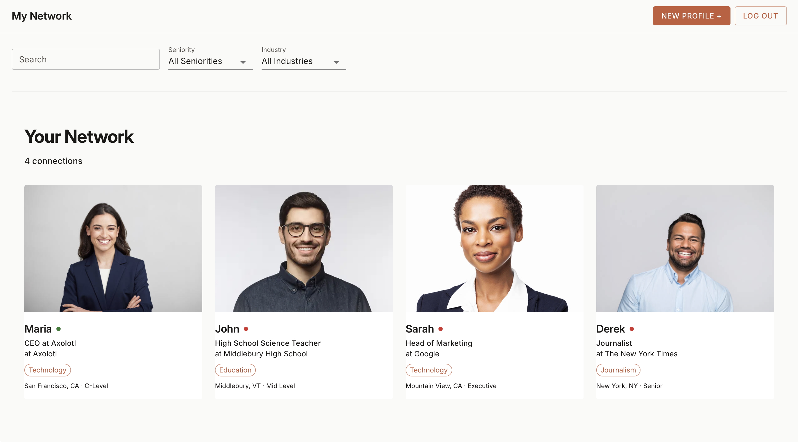
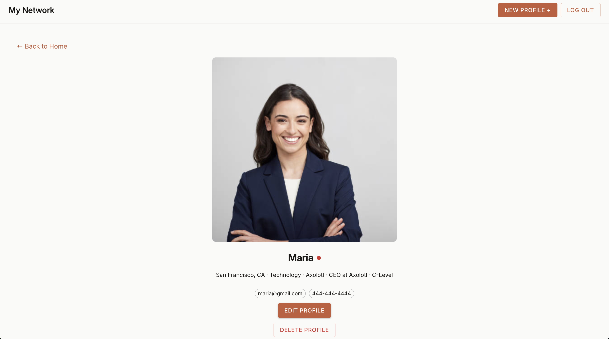
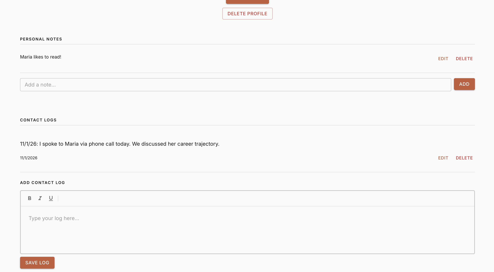
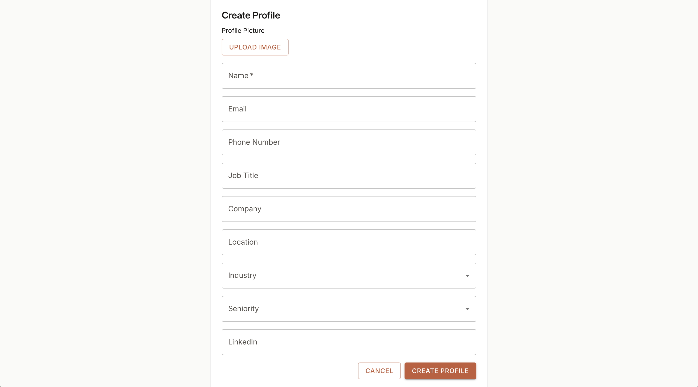
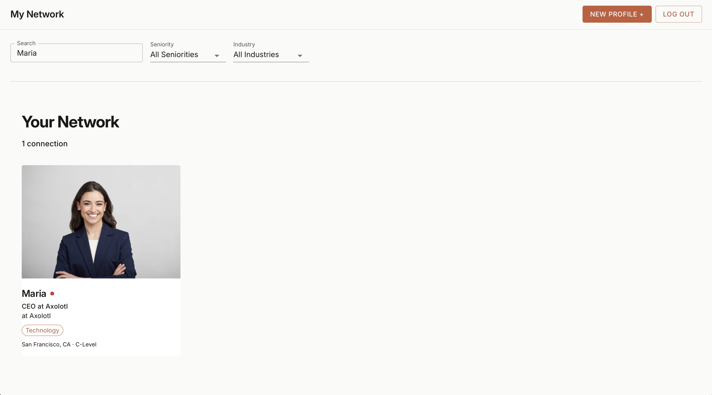
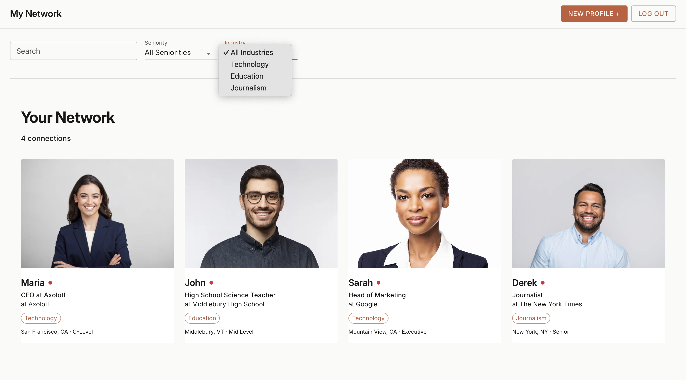
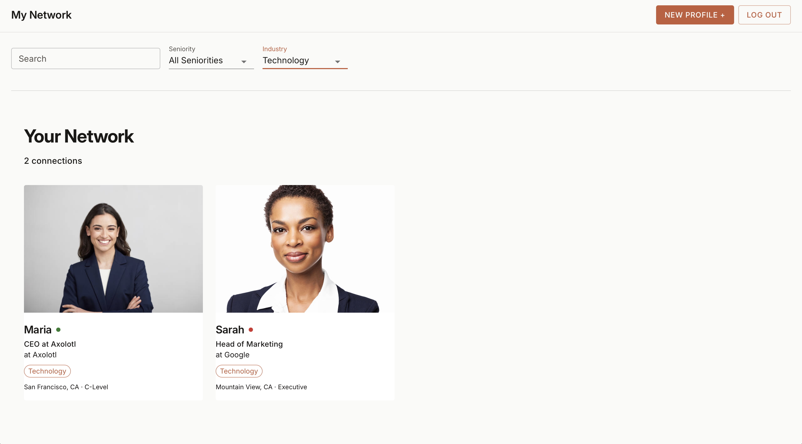
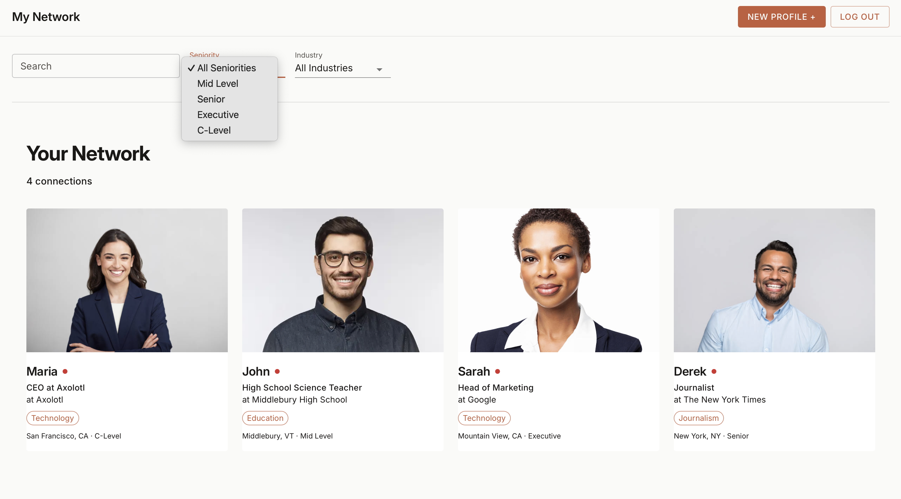

# Axolotl: a personal networking tracker

Axolotl helps students keep their professional networks organized. Spreadsheets of contacts and outreach quickly become hard to manage, so Axolotl enables users to create profiles for each of their connections with notes, a log of past conversations, and a status that shows when you're due to get back in touch.

## Features

- **Accounts:** sign up, log in, and password reset with Supabase Auth. Row-level security means each user can only see their own data.
- **Connection profiles:** create, edit, and delete contacts with company, role, industry, seniority, location, email, phone, LinkedIn, and a profile photo (uploaded to Supabase Storage).
- **Search and filtering:** search by name, company, or location, and filter by seniority and industry.
- **Keep-in-touch status:** each connection shows green, yellow, or red based on how long it's been since you last spoke (30 and 90 day thresholds).
- **Contact log:** record dated, rich-text notes from each conversation (TipTap editor).
- **Personal notes:** quick notes to remember details about each connection.
- **Quick email:** one-click `mailto:` links.
- **Validation and feedback:** form validation (required fields, email and phone checks), toast notifications, and delete confirmations.

## Screenshots

| Profile view                      | Personal notes and contact log                   |
| --------------------------------- | ------------------------------------------------ |
|  |  |

| Create a profile                               | Search                                |
| ---------------------------------------------- | ------------------------------------- |
|  |  |

| Filter by industry                                  | Filtered results                                     |
| --------------------------------------------------- | ---------------------------------------------------- |
|  |  |

| Filter by seniority                                   |     |
| ----------------------------------------------------- | --- |
|  |     |

## Tech stack

| Area     | Tools                                                             |
| -------- | ----------------------------------------------------------------- |
| Frontend | React 19, React Router 7, TypeScript, Material UI, TipTap         |
| Backend  | Supabase (Postgres, Auth, Storage, row-level security)            |
| Testing  | Vitest, React Testing Library, Playwright                         |
| Tooling  | Vite, Biome (lint/format), Husky + lint-staged, GitHub Actions CI |

## My contributions

I was one of five developers on the team. My main work:

- Set up the Supabase backend and the initial routing and navigation
- Built authentication (log in and sign up)
- Built the personal connections gallery, the profile snapshot cards, and the routing into the full profile view
- Built the search and filtering component and later merged search and filtering into one control
- Added profile image upload (create and edit forms) with a fallback image
- Wrote the row-level security policies for conversation logs and fixed security issues
- Added form validation (required name, valid phone and email), the mail-to feature, and delete confirmations
- Moved the UI from inline styles to Material UI and styled the home page
- Wrote component tests and kept CI passing

## Team

Built for CS 312 (Software Development) at Middlebury College, Spring 2026, by Melanie Forney, Zermina Khan, Jackson McKersie, Cocoroco Kitai, and Frederick Wessel. Shared with the team's permission.
